# InstaDM

An Android Instagram Direct client with a Go protocol core.

[](LICENSE)
[](#requirements)
[](#requirements)

InstaDM is an unofficial, experimental Instagram DM client. It pairs a Jetpack
Compose app with a Go core that speaks the Instagram messaging protocol, so the
inbox, conversations, sending, and realtime delivery all work without the
official app.

> **Warning:** InstaDM is not affiliated with, endorsed by, or supported by
> Instagram or Meta. Third-party clients can violate Instagram's Terms of
> Service and may get an account restricted or banned.

## Contents

- [Features](#features)
- [Screenshots](#screenshots)
- [Requirements](#requirements)
- [Build](#build)
- [Releases](#releases)
- [Run](#run)
- [Sign in](#sign-in)
- [Command-line core](#command-line-core)
- [Repository layout](#repository-layout)
- [Development](#development)
- [Status and limitations](#status-and-limitations)
- [Disclaimer](#disclaimer)
- [License](#license)

## Features

**Android app**

- In-app Instagram login in a WebView. 2FA, challenges, consent, and checkpoints
  stay on Instagram's own page; the app never handles the password.
- Sessions are encrypted with a non-exportable Android Keystore key and stored
  in `noBackupFilesDir`, never in backups or the repo.
- Inbox with cached previews, avatars, unread badges, group attribution, and
  pull-to-refresh.
- Conversations page 30 messages at a time and scroll back to the start of the
  thread, keeping the viewport stable while older pages load.
- Send text, photos, videos, files, and voice notes. Every send is an optimistic
  bubble plus a durable outbox row that retries with the same offline threading
  ID after a failure or process death.
- Inline images, GIFs, stickers, videos, and reels, plus a full-screen viewer for
  attachments and shared reels.
- Voice notes record with hold-to-send, slide-up to lock, and slide-left to
  cancel, then play inline with a waveform and tap-to-seek.
- Replies (swipe or long-press), reactions (double-tap to like, long-press for
  the full set), edits, unsend, read receipts, and per-message seen ticks.
- Instagram's like and reaction activity entries (`kind=reaction-log`, such as
  "Liked a message") are kept out of the transcript: the reaction itself already
  shows on the bubble, while the entry still appears in the inbox preview and
  notifications.
- Share cards for posts, stories, reels, and external pages: the preview (or reel
  cover) sits on top and a clean link strip underneath. Tracking parameters are
  stripped and Instagram shares read `/reel/…`, `/p/…`, or `/stories/…`, while
  tapping still opens the full URL. Tapping a reel cover plays it in the
  full-screen viewer.
- Realtime delivery through a foreground `dataSync`/`remoteMessaging` service, so
  new messages, edits, deletes, reactions, and receipts land even when the UI is
  in the background. Background messages stack into one notification per
  conversation: groups show the group name on top with each sender and profile
  picture on their messages, tapping a notification opens that chat, and the
  notification goes away once that conversation is read.
- Material 3 with Material You colors, date headers, a two-pane inbox/chat layout
  at 840 dp and wider, and TalkBack-friendly controls.
- Bounded storage: at most 1,000 messages per thread and a 250 MB media cache,
  with 8 MB image and 25 MB other-attachment upload caps.

> **Note:** Android does not let a normal app keep a connection alive in the
> background; the supported way is a foreground service, and every foreground
> service must show an ongoing notification. That notification is the cost of
> realtime delivery: it reports the connection state (`Live` when connected) and
> carries a **Stop** action, which ends background delivery until the app is
> opened again.

**Go core and CLI**

- Cookie validation and normalization, with rotated session cookies exported
  after successful calls.
- `mailbox`, `thread` (with older-page cursors), `send`, `send-media`, `send-new`,
  `media`, `mark-read`, `react`, `edit`, `unsend`, `mute`, `pin`, and `watch`.
- A durable CLI outbox (`outbox list/retry/remove`) that reuses the original OTID.
- An NDJSON `watch` stream with reconnect backoff and permanent-error handling.
- A JSON-only `gomobile` wrapper (`go-core/mobile`) that the app embeds as
  `igcore.aar`.

## Screenshots

Captured from the offline demo build on an API 37 emulator.

<!-- demo-screenshots:start -->

### Light

<table>
    <tr>
      <td align="center">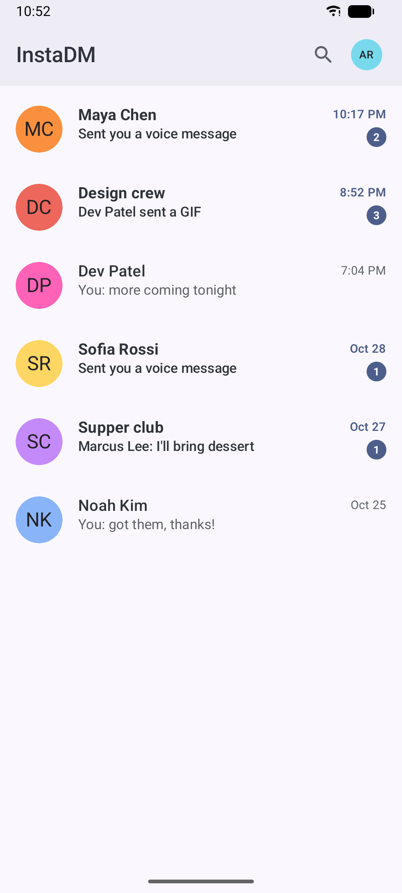<br><sub>Inbox</sub></td>
      <td align="center">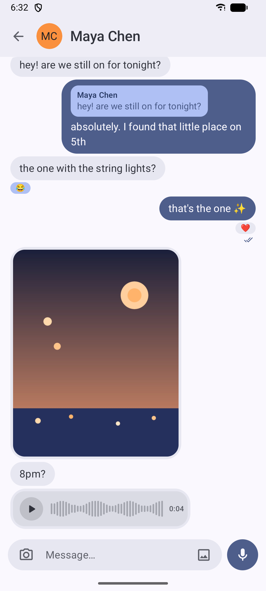<br><sub>Chat</sub></td>
      <td align="center"><br><sub>Media viewer</sub></td>
      <td align="center">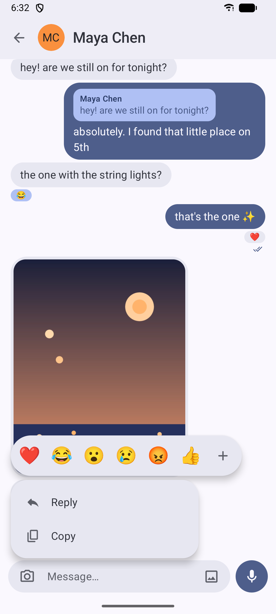<br><sub>Message actions</sub></td>
    </tr>
    <tr>
      <td align="center"><br><sub>Voice note</sub></td>
      <td align="center">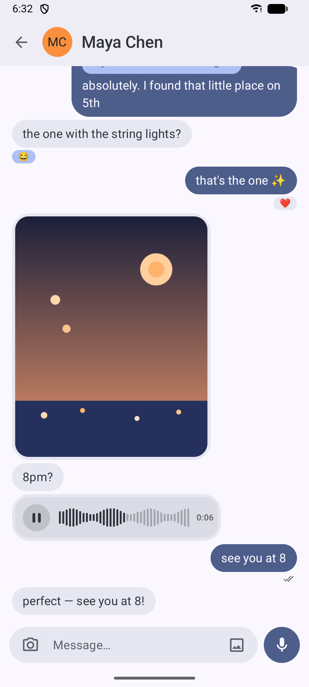<br><sub>Send and reply</sub></td>
      <td align="center">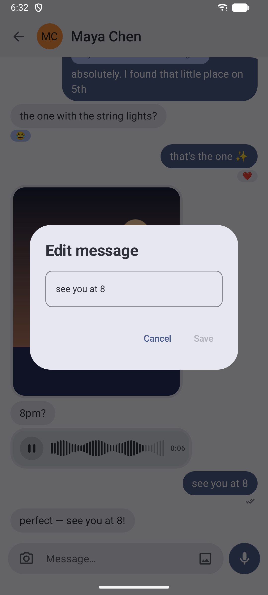<br><sub>Edit</sub></td>
      <td align="center">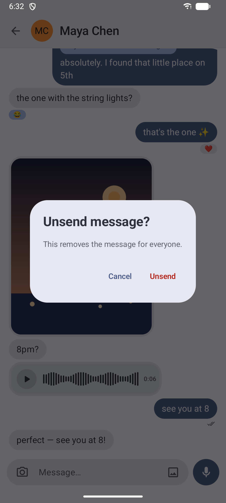<br><sub>Unsend</sub></td>
    </tr>
    <tr>
      <td align="center">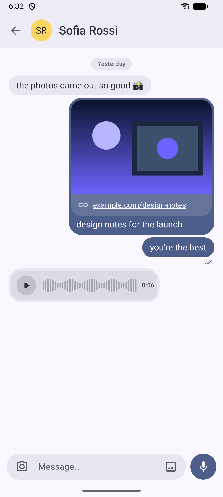<br><sub>Links and voice</sub></td>
      <td align="center">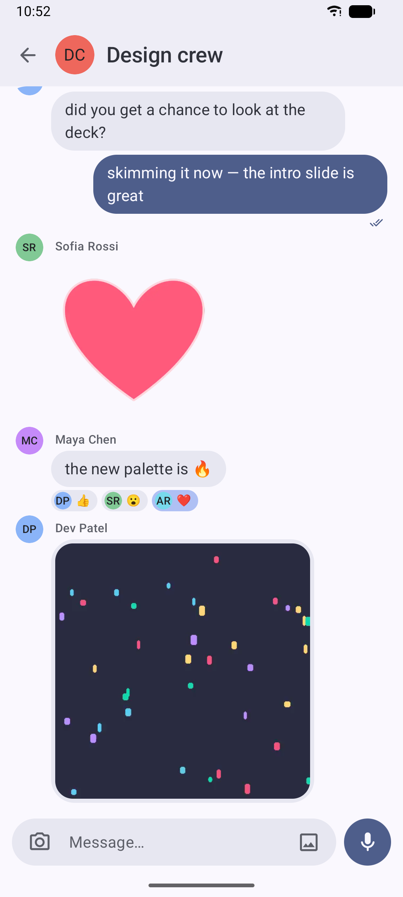<br><sub>Group chat</sub></td>
      <td align="center">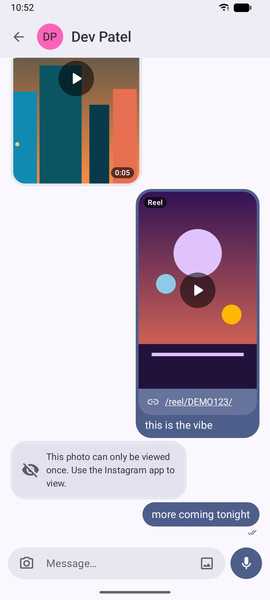<br><sub>Video, reel, view-once</sub></td>
      <td></td>
    </tr>
</table>

### Dark

<table>
    <tr>
      <td align="center">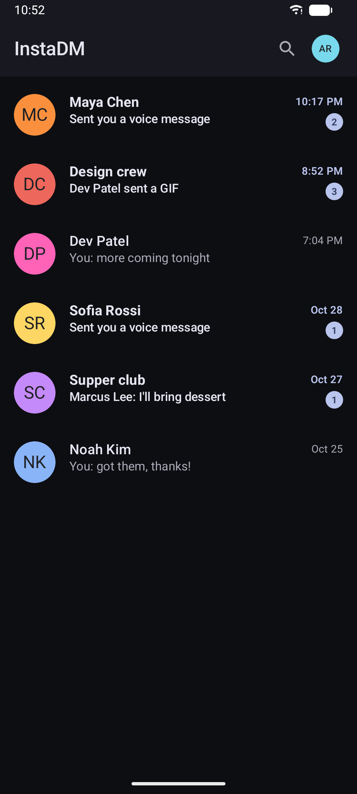<br><sub>Inbox (dark)</sub></td>
      <td align="center">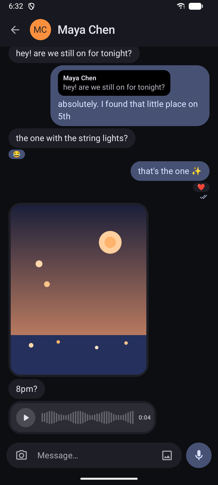<br><sub>Chat (dark)</sub></td>
      <td align="center">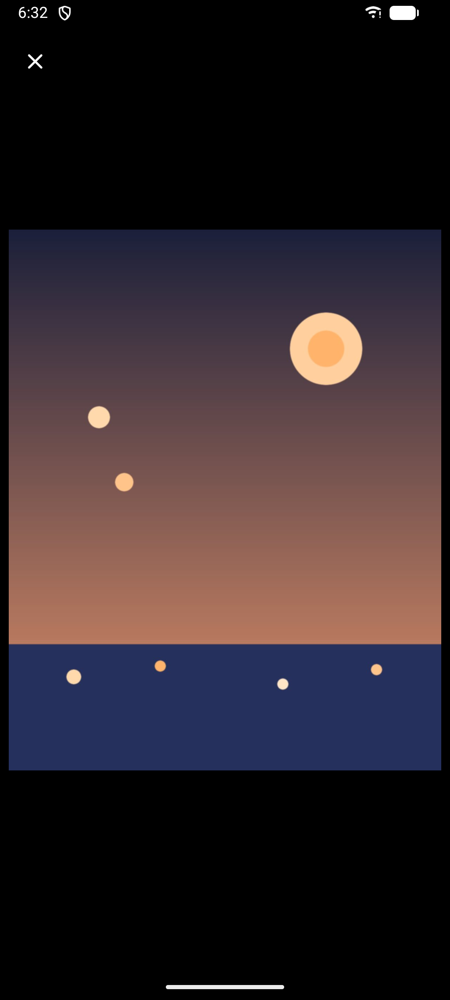<br><sub>Media viewer (dark)</sub></td>
      <td align="center">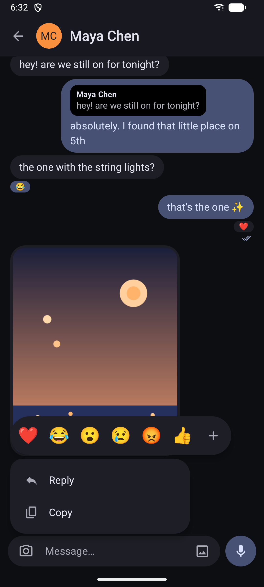<br><sub>Message actions (dark)</sub></td>
    </tr>
    <tr>
      <td align="center">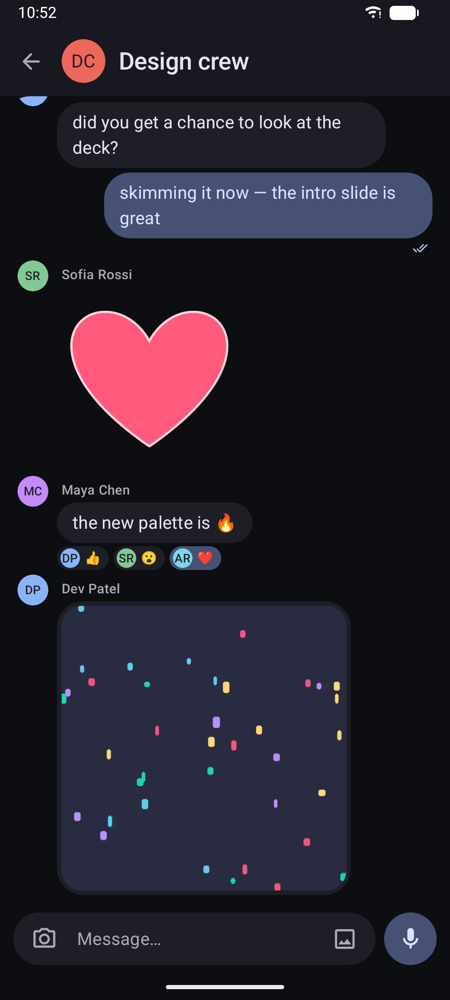<br><sub>Group chat (dark)</sub></td>
      <td></td>
      <td></td>
      <td></td>
    </tr>
</table>

### Two-pane

<table>
    <tr>
      <td align="center">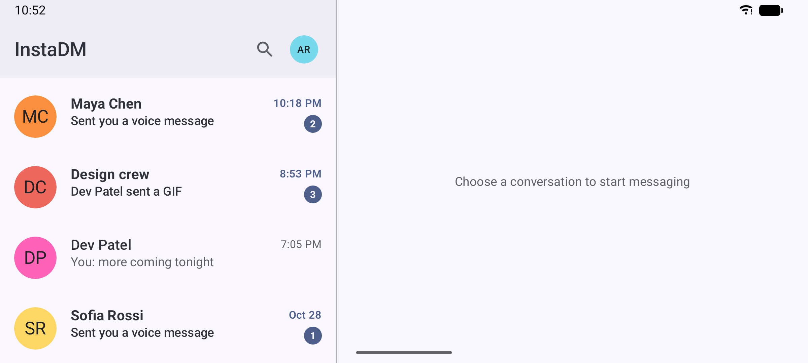<br><sub>Two-pane inbox</sub></td>
      <td align="center">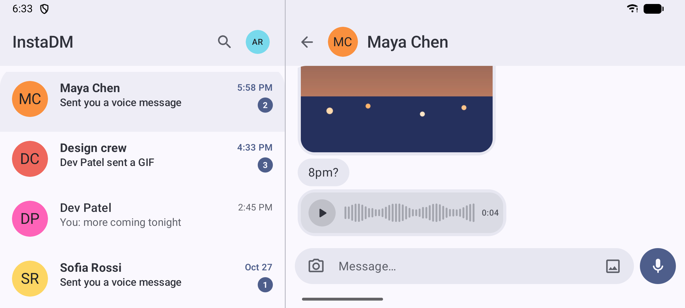<br><sub>Two-pane chat</sub></td>
    </tr>
</table>

<!-- demo-screenshots:end -->

## Requirements

- **Go 1.27.1+** for the core and CLI.
- **JDK 25** for the Gradle daemon; the wrapper pins the toolchain.
- **Android SDK** with `compileSdk` 37 and an NDK under `$ANDROID_HOME/ndk`.
  `minSdk` is 24 and `targetSdk` is 37.
- **`gomobile` and `gobind` on `PATH`:**

  ```bash
  go install golang.org/x/mobile/cmd/gomobile@latest
  go install golang.org/x/mobile/cmd/gobind@latest
  ```

- **adb** and a device or emulator for instrumented tests and real-account runs.

Toolchain versions are pinned in `gradle/libs.versions.toml` (Gradle 9.6,
AGP 9.4, Kotlin 2.2, Compose Material 3).

## Build

The Android AAR is generated locally and is not committed:

```bash
# 1. Compile the Go core into app/libs/igcore.aar
./scripts/build-android-aar.sh

# 2. Build the debug APK
./gradlew :app:assembleDebug
```

The APK lands in `app/build/outputs/apk/debug/app-debug.apk`. The debug APK is a
single universal build with all four gomobile ABIs and is about 93 MB.

For release, build the per-ABI APKs in one step:

```bash
./scripts/build-release.sh
```

It rebuilds the stripped AAR and writes one APK per ABI under
`app/build/outputs/apk/release/`, about 21–23 MB each. Without signing variables
the files are `app-<abi>-release-unsigned.apk`; with them they are
`app-<abi>-release.apk`. The normal release path is a version tag, which runs
the GitHub Actions workflow; see [Releases](#releases).

The AAR script strips Go debug info (`-trimpath -ldflags="-s -w"`), which cuts
about a third off each `libgojni.so`. To build a smaller AAR for one
architecture, pass `ABIS` (any of `armeabi-v7a`, `arm64-v8a`, `x86`, `x86_64`):

```bash
ABIS=arm64-v8a ./scripts/build-android-aar.sh
```

Pass `STRIP=0` to keep Go symbols when debugging native crashes. Plain
`./gradlew :app:assembleRelease` still produces a single universal APK; the
release script enables `-Pinstadm.abiSplits=true` for the per-ABI outputs.

The script defaults `ANDROID_HOME` to `$HOME/Android/Sdk` and picks the newest
NDK under `$ANDROID_HOME/ndk`.

## Releases

Pushing a `vX.Y.Z` tag runs `.github/workflows/release.yml`. It builds the
stripped AAR, signs the four APKs, and attaches
`instadm-<version>-<abi>.apk` plus `SHA256SUMS` to the GitHub Release.
`versionName` is the tag without `v`; `versionCode` is
`major*10000 + minor*100 + patch` (for example `v1.2.3` becomes 10203). Do not
edit the version fields in `app/build.gradle.kts` for a release; the workflow
overrides them from the tag.

```bash
git tag v1.2.3
git push origin v1.2.3
```

Create the release keystore once and add it under Settings → Secrets and
variables → Actions:

```bash
keytool -genkeypair -v -keystore instadm-release.jks -alias instadm \
  -keyalg RSA -keysize 4096 -validity 10000
base64 -w0 instadm-release.jks   # INSTADM_KEYSTORE_BASE64
```

| Secret | Value |
| --- | --- |
| `INSTADM_KEYSTORE_BASE64` | base64 of the keystore |
| `INSTADM_KEYSTORE_PASSWORD` | keystore password |
| `INSTADM_KEY_ALIAS` | key alias |
| `INSTADM_KEY_PASSWORD` | key password |

The default PKCS12 keystore uses the keystore password for the key too: press
Enter at the key-password prompt and store the same value in both password
secrets. Different passwords require `-storetype JKS`, which is legacy.

Back up the keystore; a lost key means installed releases cannot be updated.
Most phones use `arm64-v8a`; `x86` and `x86_64` are emulator builds. Debug and
release builds use different keys, so uninstall a debug build before installing
a release APK — that also deletes app data.

Run the workflow manually with a version to produce signed artifacts without
publishing. For a local signed build, export the same variables:

```bash
export INSTADM_KEYSTORE=instadm-release.jks INSTADM_KEYSTORE_PASSWORD=... \
  INSTADM_KEY_ALIAS=instadm INSTADM_KEY_PASSWORD=...
VERSION=1.0.0 ./scripts/build-release.sh -PversionCode=10000 -PversionName=1.0.0
```

## Run

```bash
./gradlew :app:installDebug
adb shell am start -n com.goldrift.instadm/.MainActivity
```

On first launch the app shows Instagram's login page. Once `sessionid`,
`csrftoken`, and `ds_user_id` exist, it validates them by loading the mailbox
and only then persists the encrypted session.

## Sign in

Normal use happens entirely in the app: the WebView is Instagram's own login UI,
so two-factor prompts and checkpoints behave as they do on the web.

For development and the runtime smoke test, debuggable builds also accept a
cookie file at the app-specific external path. It is read only when no encrypted
session exists, so replacing it after login requires clearing app data first:

```bash
adb shell mkdir -p /sdcard/Android/data/com.goldrift.instadm/files
adb push ~/.config/instadm/cookies.json \
  /sdcard/Android/data/com.goldrift.instadm/files/cookies.json
```

The debug cookie file is excluded from Android backup, and the encrypted session
is kept only in `noBackupFilesDir`.

## Command-line core

`go-core` is usable on its own for scripted checks and real-account testing:

```bash
cd go-core

go run ./cmd/igcli mailbox --cookies ~/.config/instadm/cookies.json
go run ./cmd/igcli thread <thread-id> --cookies ~/.config/instadm/cookies.json
go run ./cmd/igcli send <thread-id> "hello" --cookies ~/.config/instadm/cookies.json
go run ./cmd/igcli watch --cookies ~/.config/instadm/cookies.json
```

The CLI accepts a flat JSON cookie file, a Cookie-Editor style array, a raw
`Cookie` header, or `--cookies -` for stdin. See
[`go-core/README.md`](go-core/README.md) for every command, flag, output shape,
and the pinned upstream protocol dependency.

## Repository layout

| Path | Contents |
|---|---|
| `app/` | Android app, one Gradle module, Jetpack Compose. |
| `app/libs/igcore.aar` | Generated by `scripts/build-android-aar.sh`; not committed. |
| `go-core/igcore/` | Protocol calls and normalized JSON views. |
| `go-core/cmd/igcli/` | CLI dispatch and the file outbox. |
| `go-core/mobile/` | JSON-only gomobile API used by the app. |
| `go-core/fixtures/` | Synthetic, redacted mailbox and thread samples. |
| `scripts/` | AAR build script and demo screenshot automation. |

The app keeps Room as its source of truth; the Go core owns only session and
protocol state. `go-core` is a thin normalized layer over the pinned
[`mautrix-meta`](https://github.com/mautrix/meta) library and does not invent
endpoints or field names.

## Development

Go checks, from `go-core/`:

```bash
go build ./...
go vet ./...
go test ./...
```

Android checks, from the repository root:

```bash
./gradlew :app:testDebugUnitTest
./gradlew :app:lintDebug
./gradlew :app:connectedDebugAndroidTest   # needs a device/emulator
```

The runtime smoke test loads the mailbox, the first thread, and an older page,
then waits for a `connected` watch event. It skips when no cookie file exists:

```bash
./gradlew :app:connectedDebugAndroidTest \
  -Pandroid.testInstrumentationRunnerArguments.class=com.goldrift.instadm.GoBindingSmokeTest
```

CI only runs the tag-driven release workflow; these local checks remain the gate
for normal changes. `connectedDebugAndroidTest` may reinstall the app and clear
its external files, so real-account runs are more reliable when you install both
APKs, push the cookie file, and invoke the runner directly.

### Offline demo and screenshots

`scripts/demo-screenshots.sh` builds the offline demo app, runs it on the
`Medium_Phone_API_37.0` emulator, replaces the light, dark, and two-pane captures
in `docs/screenshots/`, and regenerates the screenshot gallery above. The block
between the `demo-screenshots` markers is generated; do not edit it by hand:

```bash
./scripts/demo-screenshots.sh
```

The demo is a separate build (`com.goldrift.instadm.demo`) with fictional
conversations, generated media, and no `INTERNET` permission. It has its own
storage sandbox, so it never reads a real session. The demo shares the app's
source, so UI and feature changes arrive on the next build; only new demo
content needs a change in `app/src/demo`. Build or install it directly with:

```bash
./gradlew :app:assembleDemo
adb install -r app/build/outputs/apk/demo/app-demo.apk
```

The screenshot suites live in `src/androidTestDemo/` and need the demo
instrumentation target, which the script passes automatically:

```bash
./gradlew :app:connectedDemoAndroidTest \
  -Pinstadm.testBuildType=demo \
  -Pandroid.testInstrumentationRunnerArguments.class=com.goldrift.instadm.demo.screenshots.DemoScreenshotTest
```

The test target defaults to `debug`, so the ordinary device tests and
`connectedDebugAndroidTest` are unchanged. The script leaves the latest demo APK
installed on the emulator when it finishes, and relinks the README gallery with
the newly captured files. `docs/screenshots/` is committed; the intermediate
device copy lives at `/sdcard/Download/instadm-demo`.

Please keep real cookies and unredacted captures out of issues and pull
requests; `go-core/fixtures/` holds synthetic samples only.

## Status and limitations

InstaDM works, but it is still early:

- Single account only. There is no logout or session-expiry UI yet; an expired
  session shows a manual "log in again" action. Account switching is out of
  scope.
- View-once photos and videos are deliberately never fetched; their bubbles point
  to the official app.
- Instagram can challenge or block an embedded browser. The login uses a desktop
  Chrome user agent because Instagram's mobile Bloks login page renders with a
  zero-height root in Android WebView.
- The protocol is unofficial and can change at any time, so features may break
  without a release.
- The inbox shows a search placeholder, but in-app search is not implemented.
- The shared protocol library is AGPL-3.0, so this project is too.

## Disclaimer

This project is provided for personal, educational use. It is not affiliated
with Instagram or Meta and comes with no warranty. You are responsible for how
you use it and for complying with Instagram's Terms of Service and any local law.
Using an unofficial client can result in account restrictions, so test with a
secondary account.

## License

InstaDM is licensed under the GNU Affero General Public License, version 3 or
later. See [`LICENSE`](LICENSE).

Third-party components and their licenses are listed in
[`THIRD_PARTY_NOTICES.md`](THIRD_PARTY_NOTICES.md).
